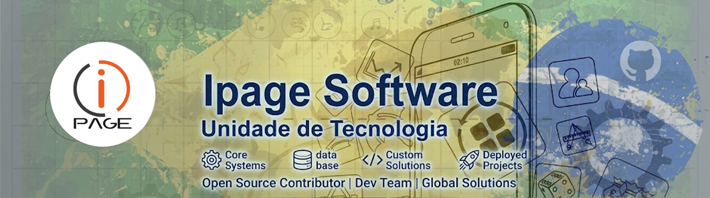
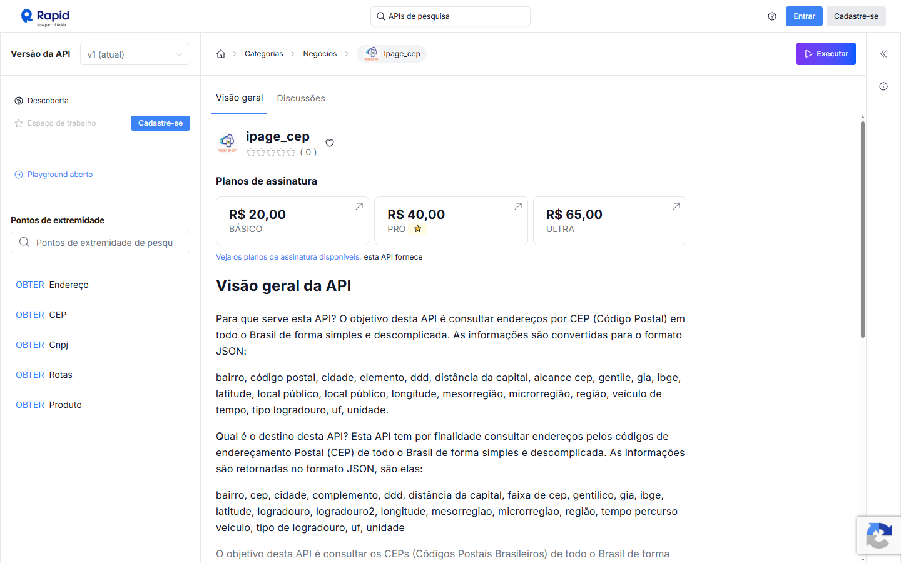
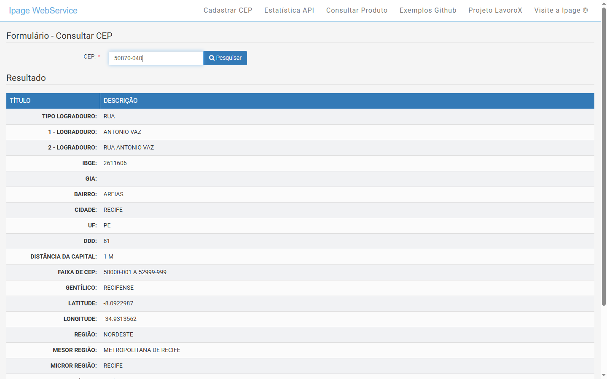
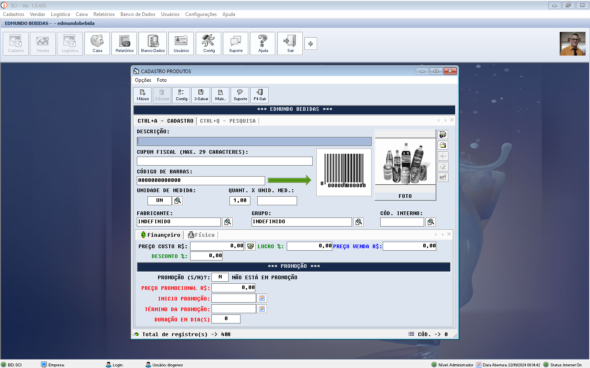
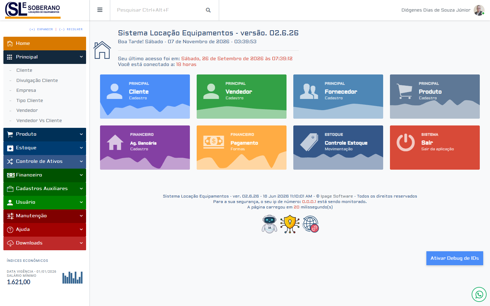

 

## 👋 Olá! Nós somos a Ipage Software

A IPAGE ® é uma Empresa voltada ao desenvolvimento de soluçðes para desktop, web, mobiles, aplicaçðes web e atua também nos seguimentos de representação comercial, sindicatos, corretoras e dentre outros.

Estamos sempre em busca de novos investimentos na área tecnológica a nível de software para podermos oferecer aos nossos clientes o que há de mais moderno e atual.

A Empresa conta hoje com uma gama diversificada de soluçðes para diversas áreas tanto para Windows ®, como para Web e Mobile. O nosso grande diferencial é poder atuar junto com os nossos clientes e ter como resultado final um produto que atenda de fato as suas necessidades.

## Produtos e Serviços - API

Desenvolvimento de API para diversas finalidades e propósitos, abaixo algumas API's de sucesso.

- 🌐 **CEP:** Busca Avançada de CEPS com Geolocalização.
- 🌐 **Cálculo de rotas:** Calcula a kilometragem e o valor correspondente entre pontos definidos pelo usuário.
- 🌐 **Dados CNPJ:** Simplifique seu cadastro de pessoa jurídica com a nossa API.
- 🌐 **Geolocalização:** Registre os dados de geolocalização dos seus clientes.

## Software

Desenvovimento de software para plataforma plataforma Windows.

✅ Gestão Representações
✅ Gestão Depósito de Bebidas
✅ Gestão Financeira
✅ Gestão Fornecedor Panificação
✅ Gestão Estoque
✅ Dentre Outros

---

## Aplicação Web

Desenvovimento de aplicações em nuvem.

✅ Gestão Representações
✅ Gestão Oficina Técnica
✅ Gestão Sindicatos
✅ Gestão Associados
✅ Gestão Financeira
✅ Dentre Outros

---

## 📺 Os vídeos mais vistos do canal

<table>
  <tr>
    <td width="33%" align="center"> <b>Aula 01 - Flat File - Instalação do Visual Basic 6 Portable</b></td>
  </tr>
</table>

**[▶ Ver todos os vídeos no canal](https://www.youtube.com/@Ipagesoftware)**

---

